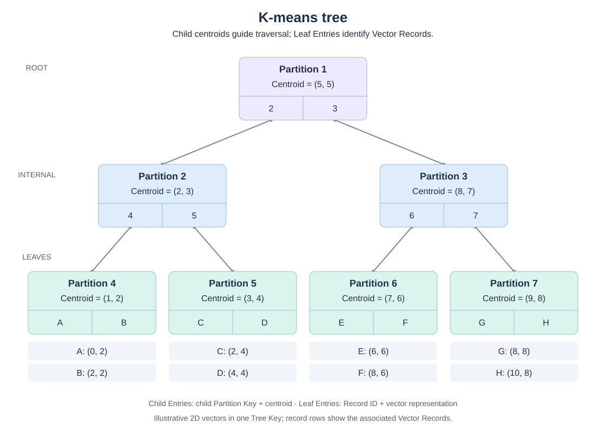

# KTANN

KTANN (**K-means Tree Approximate Nearest Neighbor**) is an embeddable Rust
library that combines approximate nearest-neighbor search, typed metadata
filtering, and transactional updates. It keeps vectors and their index membership
in sync as records are inserted, updated, and deleted, with storage backends for
in-memory, embedded, and distributed deployments.

**Status:** active development, with no stable release. Search, filtering, online
updates, resumable initial builds, and Memory, RocksDB, and FoundationDB adapters
are implemented. APIs and persistent formats may change without backward
compatibility. Distributed execution and scalability goals are described under
[Project goals](#project-goals).

## Quick start

From a checkout, using the latest stable Rust toolchain:

```sh
cargo run --example basic
```

The [complete example](examples/basic.rs) creates an in-memory index, inserts a
three-dimensional vector, searches it, and shuts down the runtime. Its main
operations are:

```rust
let runtime = Runtime::new(MemoryBackend::new(), RuntimeConfig::default())?;
let index = runtime
    .create_index("vectors", IndexConfig::new(3, Metric::L2)?)
    .await?;

index
    .insert(Record::new(
        Bytes::from_static(b"first"),
        vec![1.0, 0.0, 0.0],
        vec![],
    )?)
    .await?;

let result = index
    .search(SearchRequest::new(vec![1.0, 0.0, 0.0], 1)?)
    .await?;
```

To embed KTANN, use the `ktann` crate and a storage adapter from this checkout as
path dependencies. Start with the [Memory adapter guide](ktann-memory/README.md),
then see the [API guide](docs/design/api.md) for schemas, filters, updates, and
search options. For initial datasets, see [Bulk Build](docs/design/bulk-build.md).

## Capabilities

- **Keep search current with your data.** A mutation commits the vector, metadata,
  and index membership together. Each query reads a consistent snapshot, including
  filtering and reranking, so it does not observe partially applied updates.
- **Update continuously without rebuilding the index.** Insert, upsert, delete,
  and atomic batches work on a live index. Background splits and merges adapt its
  structure while keeping every committed state searchable.
- **Search within the data that matters.** Combine vector similarity with typed
  metadata predicates using SQL `WHERE` semantics. Route by fields such as tenant
  or collection, prune partitions using metadata summaries, and apply exact
  filtering to returned hits.
- **Combine partitioned storage with graph-accelerated routing.** Optional local
  HNSW graphs make wider internal partitions practical to search, letting more
  child centroids compete at each routing step while keeping the routing structure
  partitioned. Compact RaBitQ7 representations rank leaf candidates before exact
  reranking. L2, cosine, and inner-product metrics are supported.
- **Choose storage to fit the application.** Use Memory for ephemeral indexes,
  RocksDB for embedded persistence, or FoundationDB for distributed transactional
  storage, through the same index API and logical transaction contract.
- **Load existing datasets with resumable builds.** Bulk Build prepares an index
  from an immutable input snapshot, checkpoints progress, and publishes the index
  after loading and validation. Interrupted work can resume.

## Architecture

Records and index entries live in the same transactional backend. Foreground
writes update them atomically; background maintenance splits and merges partitions
without making committed data unsearchable. Queries use one consistent snapshot
and do not perform structure maintenance.

KTANN organizes vectors in centroid-routing trees. Optional metadata fields called
**Tree Keys** separate records into trees, so a query can first select the relevant
tenant or collection. Within each tree, internal partitions route by centroid
distance and leaves hold vector entries.



The diagram shows one tree with illustrative two-dimensional vectors. Each
Child Entry holds a child Partition Key and its centroid; each Leaf Entry
identifies a Vector Record and stores its search representation. The rows below
the leaves show the associated records, not an additional tree level.

The design combines
[C-SPANN](https://www.cockroachlabs.com/blog/cspann-real-time-indexing-billions-vectors/)-style
partitioned trees with the broader centroid exploration of
[SPANN](https://www.microsoft.com/en-us/research/wp-content/uploads/2021/11/SPANN_finalversion1.pdf)
and [SPFresh](https://arxiv.org/html/2410.14452v1). Partitioned trees distribute
routing and maintenance, but small internal partitions can exclude relevant
branches early during bounded search. A global centroid graph offers broader
exploration but is harder to distribute.

KTANN uses wider internal partitions to let more child centroids compete at each
routing decision, with optional HNSW to reduce the cost of searching them. Each
graph belongs to one partition, preserving the tree as the storage and maintenance
structure without requiring a single resident global graph. See the
[partition-local HNSW design](docs/design/partition-local-hnsw.md) for details.

Search is approximate: exact reranking gives exact distances for selected
candidates, not guaranteed global top-k results. Query budgets bound traversal
and reranking, and results report budget exhaustion. See the
[architecture overview](docs/design/overview.md) and
[search design](docs/design/search.md) for details.

## Storage backends

Choose a backend for the deployment. All adapters share the logical transaction
contract and core index algorithms.

| Backend | Use | Setup |
| --- | --- | --- |
| [Memory](ktann-memory/README.md) | Ephemeral indexes and local development | No external service; data is lost on restart |
| [RocksDB](ktann-rocksdb/README.md) | Persistent embedded storage | C++ toolchain and Clang/libclang for builds |
| [FoundationDB](ktann-foundationdb/README.md) | Distributed transactional storage | FoundationDB 7.3 client library and a running cluster |

Your application owns backend initialization and lifetime. Shut down the KTANN
runtime before the backend. Physical index data is not portable between backends.

## Project goals

Strong scalability, query and filtering capabilities, continuous updates, and
ease of use define the product requirements. KTANN targets both large datasets
that need distributed storage and execution, and small datasets that should run
efficiently on a single machine. These goals are not tied to particular backends.
High recall, fast construction, high query throughput, and low latency matter
across all backends.

Distributed Bulk Build is a requirement; distributed incremental writes are also
a desired capability. The current bulk scheduler distributes whole jobs across
workers with shared-filesystem requirements. It does not distribute the
construction of a single index across workers.

Strict read/write separation keeps queries free of index mutations and structure
maintenance, with the goal of scaling read capacity independently of writes.

Within the required capabilities and correctness guarantees, continuously pursue
better whole-system performance at comparable recall. Additional complexity must
provide a required capability or a meaningful, measured benefit; when outcomes
are comparable, choose the simpler design. Observability supports validation and
operation. [AGENTS.md](AGENTS.md) records the engineering rules.

## Development and benchmarks

```sh
make verify      # Format, lint, and test without FoundationDB
make bench       # Run the RocksDB smoke benchmark
make help        # List targets, including FoundationDB checks
```

Smoke benchmarks check the harness, not performance. Use the
[benchmark guide](benchmarks/README.md) for full runs, datasets, recall comparisons,
and VectorDBBench integration. Performance claims should include workload,
recall, latency, throughput, and resource costs.

The [documentation guide](docs/README.md) links the module designs and architectural
decisions. [CONTEXT.md](CONTEXT.md) defines domain terminology and system invariants.

## License

[MIT](LICENSE).
